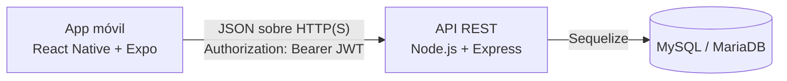
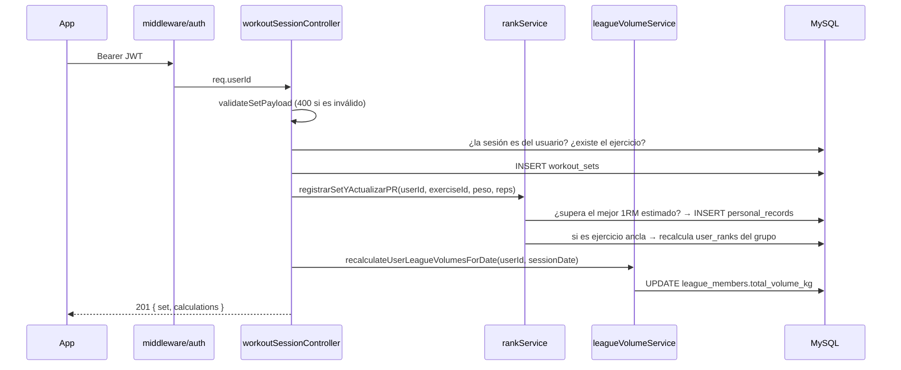

# Arquitectura

## Visión general



- La app **nunca** habla con la base de datos: todo pasa por la API REST bajo el prefijo `/api`.
- Los cálculos de 1RM, ratio, rangos y volumen de liga viven en el backend (capa de servicios), así el resultado es el mismo desde cualquier cliente.
- En desarrollo la app usa HTTP (`http://10.0.2.2:3000/api` en emulador Android). Una app publicada debe usar HTTPS (ver [`06`](./06-estado-y-limitaciones.md#camino-a-producción-y-tiendas)).

## Capas del backend

```
routes/        → URL + método HTTP + middleware (requireAuth)
controllers/   → orquesta: valida con validators/, llama a servicios/modelos, arma la respuesta
validators/    → validación y normalización de payloads (lanzan errores 400)
services/      → lógica de negocio (rankService, leagueService, leagueVolumeService, authService)
models/        → definición de tablas con Sequelize + asociaciones (models/index.js)
middleware/    → auth.js: verifica el JWT y asigna req.userId
migrations/    → esquema versionado (aplicado con npm run db:migrate)
seeders/       → catálogo inicial (grupos, ejercicios ancla, estándares)
```

Esta separación permite probar la lógica de rangos y de ligas sin levantar el servidor (`tests/rankService.test.js`, `tests/leagueService.test.js`).

> Convención importante: el middleware de autenticación deja el id del usuario en **`req.userId`**. Cualquier controlador nuevo debe leer ese campo (no existe `req.user`).

## Flujo de una petición: registrar una serie

`POST /api/workout-sessions/:id/sets`



Notas:
- Crear, editar o borrar una serie y actualizar sus PR, rangos y volumen de liga ocurre en una única transacción; un error revierte todos esos cambios.
- Crear una rutina y aplicarla (incluyendo sesión, series y recálculos derivados) también se ejecuta en una única transacción.
- Editar (`PATCH`) o borrar (`DELETE`) una serie reconstruye los PR del ejercicio desde las series persistidas y vuelve a calcular rangos y volumen dentro de esa misma transacción.

## Manejo de errores

Todos los errores salen por el manejador central de `app.js` con la forma:

```json
{ "error": true, "message": "descripción legible" }
```

Los errores 5xx devuelven siempre `"Error interno del servidor"` y se registran en consola con stack. Los controladores lanzan errores con `error.status` (400, 404, 409…) y los pasan con `next(err)`.
Excepción: `GET /api/health` responde `{ "ok": false, "database": "offline" }` con 503.

## Autenticación y seguridad actual

| Aspecto | Estado |
|---|---|
| Hash de contraseñas | bcrypt, 10 rondas; límite de 72 bytes validado |
| Token | JWT firmado con `JWT_SECRET`, expira en 7 días, sin refresh ni revocación |
| Arranque seguro | El servidor no inicia si `JWT_SECRET` falta, tiene menos de 32 caracteres o es el valor de ejemplo |
| Aislamiento de datos | Sesiones, series, rutinas y perfil se filtran por el usuario autenticado |
| CORS | Restringido por allow-list (`CORS_ALLOWED_ORIGINS`) |
| Rate limiting / `helmet` | `helmet()` global + limitador en `/api/auth` |
| Roles | No hay roles globales; crear ligas requiere email en `LEAGUE_CREATOR_EMAILS` |

## Configuración

Variables de entorno del backend (archivo `backend/.env`, plantilla en `.env.example`):

| Variable | Obligatoria | Uso |
|---|---|---|
| `DB_HOST`, `DB_PORT`, `DB_NAME`, `DB_USER`, `DB_PASSWORD` | Sí | Conexión a MySQL/MariaDB |
| `JWT_SECRET` | Sí | Firma de tokens; mínimo 32 caracteres aleatorios |
| `PORT` | No (3000) | Puerto de la API |
| `NODE_ENV` | No | Aparece en `.env.example`, pero el código actual no la lee |
| `CORS_ALLOWED_ORIGINS` | Sí (recomendado) | Orígenes permitidos separados por coma |
| `LEAGUE_CREATOR_EMAILS` | Sí (recomendado) | Emails autorizados para crear ligas |

Variable del cliente: `EXPO_PUBLIC_API_URL` (ver [`app/README.md`](../app/README.md)).

## Despliegue (propuesto, no implementado)

- **Backend:** cualquier proveedor con Node.js (Railway, Render, VPS propio).
- **Base de datos:** MySQL/MariaDB gestionado o en el mismo VPS.
- **App móvil:** EAS Build → subida manual a Google Play Console y App Store Connect.

El proveedor se decidirá cuando el MVP esté listo. Hoy no hay Dockerfile, CI/CD ni guía de backups; la lista de pendientes está en [`06`](./06-estado-y-limitaciones.md#camino-a-producción-y-tiendas).
