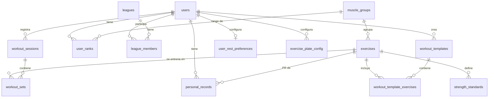

# Modelo de datos y sistema de rangos

> **Fuente de verdad del esquema:** los archivos de `backend/src/migrations/`. Este documento los resume; si hay diferencias, mandan las migraciones.

## 1. Cómo se calcula un rango

### Paso 1 — Estimar el 1RM (fórmula de Epley, [Decisión #04](./DECISIONES.md))

```
1RM_estimado = peso_kg × (1 + reps / 30)
```

Ejemplo: 80 kg × 8 reps → 80 × (1 + 8/30) = **101,33 kg**. Se guarda con 2 decimales.
Epley sobreestima cuando las repeticiones son muchas; la API conserva las repeticiones registradas para volumen, pero limita a 12 las usadas en la estimación de 1RM (ver [`06`](./06-estado-y-limitaciones.md#limitaciones-de-diseño)).

### Paso 2 — Ratio de fuerza relativa ([Decisión #01](./DECISIONES.md))

```
ratio = mejor_1RM_estimado_del_ejercicio / peso_corporal_actual_del_usuario
```

Se compara el ratio, no el peso absoluto. **Se usa el peso corporal actual del perfil**, no el de cuando se hizo la serie (el esquema no guarda peso histórico).

### Paso 3 — Comparar contra los estándares

Cada ejercicio ancla tiene cinco umbrales por género (tabla `strength_standards`). El rango es el más alto cuyo umbral es **menor o igual** al ratio. **Bronce es el piso**: un ratio por debajo del umbral de Bronce sigue dando Bronce; no existe "sin rango".

Umbrales cargados por el seeder (ratio 1RM / peso corporal):

| Ejercicio | Género | Bronce | Plata | Oro | Platino | Diamante |
|---|---|---|---|---|---|---|
| Press de banca | Hombres | 0,50 | 0,75 | 1,00 | 1,25 | 1,50 |
| | Mujeres | 0,30 | 0,45 | 0,60 | 0,75 | 0,90 |
| Sentadilla | Hombres | 0,75 | 1,00 | 1,50 | 1,75 | 2,00 |
| | Mujeres | 0,50 | 0,70 | 1,00 | 1,25 | 1,50 |
| Peso muerto | Hombres | 1,00 | 1,25 | 1,75 | 2,00 | 2,50 |
| | Mujeres | 0,60 | 0,80 | 1,10 | 1,40 | 1,75 |
| Press militar | Hombres | 0,45 | 0,65 | 0,85 | 1,05 | 1,20 |
| | Mujeres | 0,25 | 0,40 | 0,55 | 0,70 | 0,85 |
| Curl con barra | Hombres | 0,35 | 0,55 | 0,75 | 0,90 | 1,10 |
| | Mujeres | 0,20 | 0,35 | 0,50 | 0,65 | 0,80 |

Son un punto de partida razonable, no una referencia estadística; deben validarse con usuarios reales.

### Paso 4 — Rango por grupo muscular ([Decisión #02](./DECISIONES.md))

El rango de un grupo es **el mayor rango entre sus ejercicios ancla**. Hoy el catálogo tiene un ancla por grupo:

| Grupo | Ejercicio ancla |
|---|---|
| Pecho | Press de banca |
| Espalda | Peso muerto |
| Piernas | Sentadilla |
| Hombros | Press militar |
| Brazos | Curl con barra |

Consecuencias del diseño actual:
- Un usuario solo tiene fila en `user_ranks` para los grupos donde ya registró un PR de su ancla. `GET /api/users/me/ranks` devuelve únicamente esos grupos.
- Entrenar otros ejercicios (aunque sean del mismo grupo) no cambia el rango.
- **No existe un "rango general"** de la app. La idea de usar el mínimo de los cinco grupos sigue como propuesta, no implementada.

### Cuándo se recalcula ([Decisión #03](./DECISIONES.md))

| Evento | Qué se recalcula |
|---|---|
| Registrar una serie | Solo si supera el mejor 1RM estimado del ejercicio (nuevo PR) y el ejercicio es ancla |
| Editar o borrar una serie | PR del ejercicio desde las series persistidas, y rango del grupo |
| Cambiar el peso corporal del perfil | Rangos de todos los grupos con fila de rango o con PR ancla |

Si un ejercicio no tiene estándares en la base, el backend usa una tabla de respaldo en código (`DEFAULT_STANDARDS` en `rankService.js`); para un ejercicio desconocido, ese respaldo usa los umbrales de **Press de banca**.

### Volumen de liga ([Decisión #06](./DECISIONES.md))

- Por serie: `weightKg × reps`; se suman y se redondean a 2 decimales.
- Cuentan `normal`, `failure` y `drop_set`; **`warmup` se excluye**.
- Cuentan sesiones con `sessionDate` entre `seasonStart` y `seasonEnd`, ambos inclusive.
- Al unirse se calcula desde el inicio de la temporada (incluye sesiones anteriores al ingreso).
- Se actualiza al unirse y al crear, editar o borrar series (no hay job ni trigger).
- Empates: orden estable por `userId` ascendente.

---

## 2. Diagrama entidad-relación



## 3. Diccionario de datos

### Núcleo (migración `20261004000000-initial-schema`)

| Tabla | Columnas principales | Restricciones |
|---|---|---|
| `users` | `id`, `name` (100), `email` (150), `password_hash`, `gender` (`male`/`female`), `birth_date` (opcional), `bodyweight_kg` (5,2), `created_at` | `email` único |
| `muscle_groups` | `id`, `name` (50) | `name` único |
| `exercises` | `id`, `name` (100), `muscle_group_id`, `is_anchor` | `name` único |
| `strength_standards` | `id`, `exercise_id`, `gender`, `rank_level`, `bodyweight_ratio` (4,2) | único (`exercise_id`, `gender`, `rank_level`) |
| `workout_sessions` | `id`, `user_id`, `session_date` (fecha), `notes` | — |
| `workout_sets` | `id`, `session_id`, `exercise_id`, `weight_kg` (6,2), `reps`, `set_order` | — |
| `personal_records` | `id`, `user_id`, `exercise_id`, `estimated_1rm` (6,2), `achieved_at` | — |
| `user_ranks` | `id`, `user_id`, `muscle_group_id`, `current_rank`, `updated_at` | único (`user_id`, `muscle_group_id`) |
| `leagues` | `id`, `name`, `season_start`, `season_end` | — |
| `league_members` | `id`, `league_id`, `user_id`, `total_volume_kg` (10,2) | único (`league_id`, `user_id`) |

Las claves foráneas del núcleo usan `ON DELETE RESTRICT`: no se puede borrar un usuario que tenga sesiones, PR, rangos o membresías sin borrar antes esos datos.

### Métricas avanzadas (migración `20261006000000-phase1-advanced-workout-metrics`)

| Cambio | Detalle |
|---|---|
| `workout_sets` + `set_type` | `warmup` / `normal` / `failure` / `drop_set`, por defecto `normal` |
| `workout_sets` + `rest_seconds`, `actual_rest_seconds` | Descanso planeado y real (segundos), opcionales |
| `workout_sets` + `notes` | Texto libre |
| `user_rest_preferences` | `user_id` (único), `default_rest_seconds` (90), `default_warmup_rest_seconds` (60) |
| `exercise_plate_config` | `user_id`, `plate_kg` (5,2); único (`user_id`, `plate_kg`) |

### Rutinas (migración `20261006010000-phase2-routine-templates`)

| Tabla | Columnas principales | Restricciones |
|---|---|---|
| `workout_templates` | `id`, `user_id`, `name`, `description`, `routine_type` (`single`/`superset`/`circuit`) | único (`user_id`, `name`) |
| `workout_template_exercises` | `template_id`, `exercise_id`, `position`, `target_sets`, `target_reps`, `target_weight_kg`, `rest_seconds` (90), `grouping` (`main`/`paired`/`circuit`) | índice (`template_id`, `position`) |

Estas tablas, igual que `user_rest_preferences` y `exercise_plate_config`, usan `ON DELETE CASCADE`.

### Notas de diseño

- `personal_records` funciona como **historial de PR** cuando se registran series (una fila por cada nuevo máximo), pero tras editar o borrar una serie el backend **borra y recrea** una sola fila por ejercicio, perdiendo `achieved_at` histórico. Es una inconsistencia conocida.
- `league_members.total_volume_kg` es un valor derivado que se recalcula desde las series; no es fuente de verdad.
- La migración de fase 1 envuelve sus `addColumn`/`addConstraint` en `.catch(() => undefined)`: si uno de esos pasos falla, la migración continúa sin avisar y puede dejar el esquema incompleto.

## 4. Pseudocódigo de referencia

Versión simplificada de `services/rankService.js` (la real usa `findOrCreate` y consulta los estándares de la base, con respaldo en código):

```javascript
const ORDEN = ['bronce', 'plata', 'oro', 'platino', 'diamante'];

async function recalcularRangoGrupo(userId, muscleGroupId) {
  const user = await User.findByPk(userId);
  const anclas = await Exercise.findAll({ where: { muscleGroupId, isAnchor: true } });

  const rangos = [];
  for (const ejercicio of anclas) {
    const pr = await PersonalRecord.findOne({
      where: { userId, exerciseId: ejercicio.id },
      order: [['estimated1rm', 'DESC']],
    });
    if (!pr) continue;
    const ratio = Number(pr.estimated1rm) / Number(user.bodyweightKg);
    rangos.push(await calcularRangoPorRatio(ejercicio.id, user.gender, ratio));
  }

  const nuevo = rangos.reduce(
    (max, r) => (ORDEN.indexOf(r) > ORDEN.indexOf(max) ? r : max), 'bronce');
  // crea o actualiza la fila de user_ranks (userId, muscleGroupId)
}
```

## 5. Validación pendiente

- Validar la fuente y la población de cada estándar con usuarios reales.
- Confirmar qué series y variantes de ejercicio son elegibles para PR (hoy cuentan todas, incluidas las de calentamiento).
- Decidir si se conserva el peso corporal por sesión (hoy los PR históricos se comparan con el peso actual).
