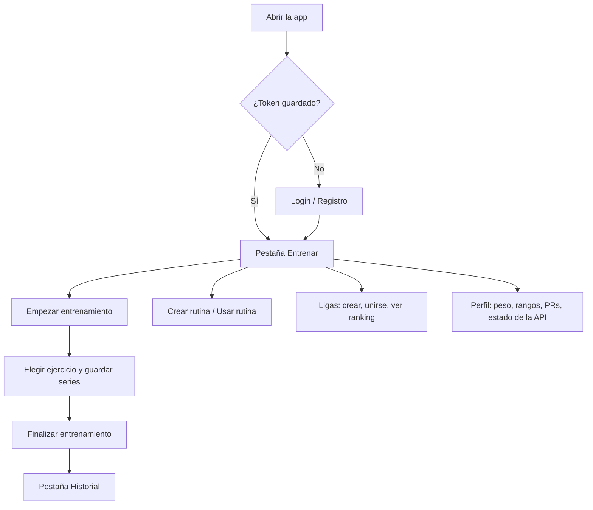

# Pantallas y flujo de usuario

La app (React Native + Expo) vive en un único componente, `app/App.js`, con navegación por **tres pestañas** (`Entrenar`, `Historial`, `Perfil`) y hojas modales para crear rutinas, ligas y elegir ejercicios. No usa una librería de navegación.

## Flujo principal

## Pantallas actuales

| # | Pantalla | Qué contiene |
|---|---|---|
| 1 | **Login / Registro** | Correo, contraseña y, al registrarse, nombre, género y peso corporal (kg) |
| 2 | **Entrenar** (pestaña) | Botones *Empezar entrenamiento* y *Crear rutina*. Con sesión activa: selector de ejercicio, carga, repeticiones, tipo de serie, descanso planeado y real con temporizador, notas y *Guardar serie*; contador de series y *Finalizar entrenamiento*. Debajo, cuando existen datos: **Rangos**, **PRs** (los 3 más recientes), **Ligas** (con *Crear*, *Unirse* y *Ver ranking*), **Rutinas guardadas** (*Usar*) y el último entrenamiento |
| 3 | **Historial** (pestaña) | Lista de sesiones y detalle con sus series y la acción *Borrar* por serie |
| 4 | **Perfil** (pestaña) | Resumen (peso y género), estado del backend, edición de nombre y peso corporal, rangos y PRs |
| 5 | **Hoja: elegir ejercicio** | Catálogo de ejercicios con su grupo muscular |
| 6 | **Hoja: crear rutina** | Nombre, descripción, tipo (`single`/`superset`/`circuit`) y ejercicios con series, repeticiones, peso y descanso |
| 7 | **Hoja: crear liga** | Nombre y fechas de inicio y fin (`YYYY-MM-DD`) |

## Comportamientos a tener en cuenta

- La sesión se guarda con `expo-secure-store` en Android/iOS y con `localStorage` en la vista web.
- Al guardar una serie, el backend recalcula PR y rango; la app solo recarga el historial y las últimas series, así que **Rangos y PRs se actualizan al volver a cargar los datos** (por ejemplo, al reabrir la app), no al instante.
- Cambiar el peso en *Perfil* recalcula los rangos existentes.
- El género solo ofrece dos opciones (`male`/`female`) porque los estándares de fuerza están definidos así.
- Las rutinas dependen de endpoints que hoy fallan con 500 (ver [`06`](./06-estado-y-limitaciones.md#bugs-conocidos)). Al cargar, la app ignora ese error y muestra la lista de rutinas vacía; al intentar *Guardar rutina* se muestra el mensaje de error.

## Ampliaciones futuras

- Notificaciones push y recordatorios de entrenamiento.
- Panel de progreso con tendencias históricas.
- Detección de estancamiento (fuera del alcance actual).
- Separar `App.js` en pantallas y hooks, y adoptar una librería de navegación.
- EAS Build y publicación en tiendas.
